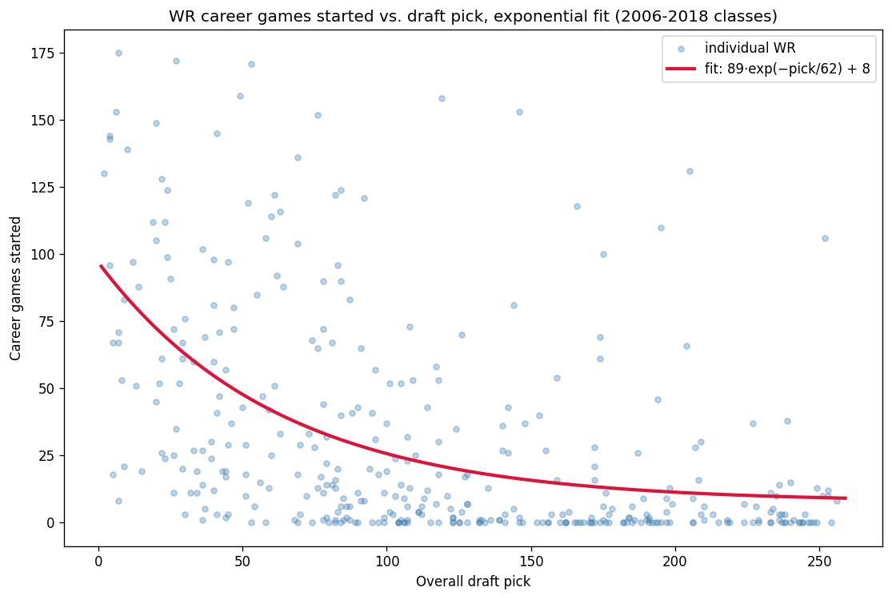
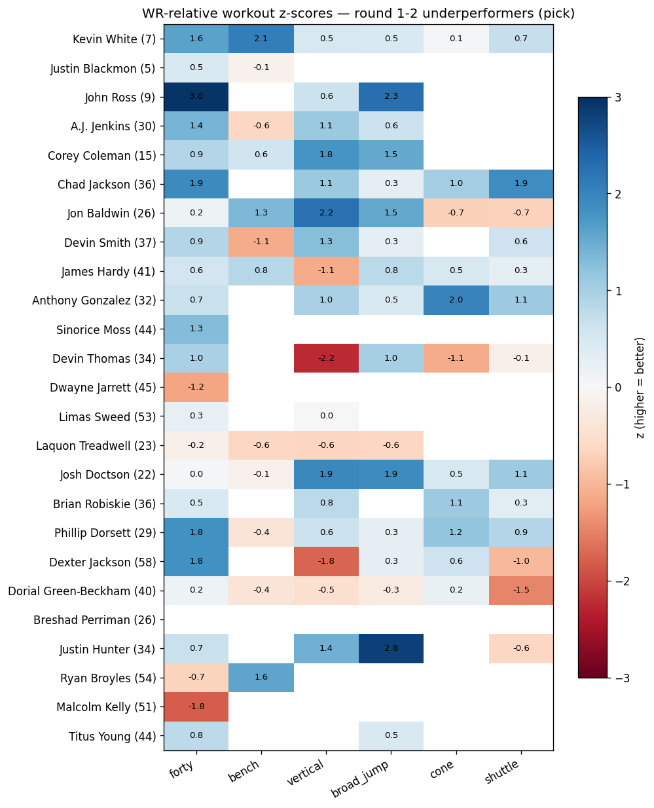
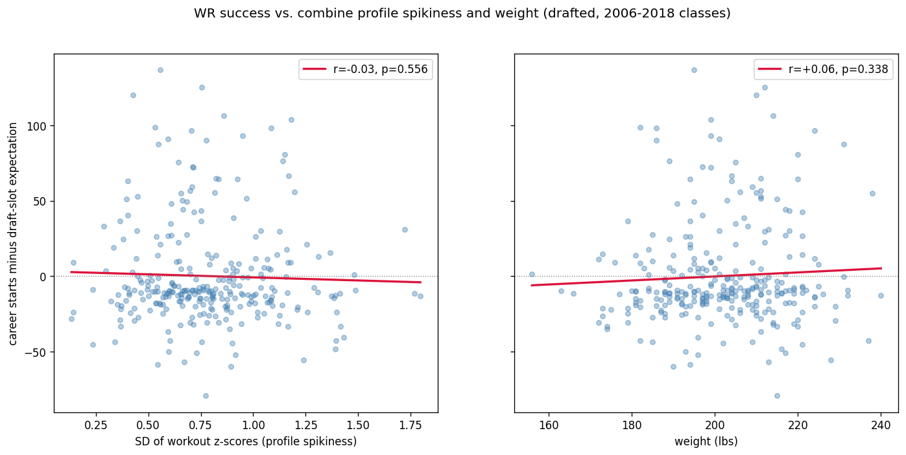

# Does a "spiky" combine predict WR busts?

**The setup.** I took every wide receiver who attended the NFL combine from
2006–2018 (601 players, via nflverse) and matched them to their career games
started through 2025 (scraped from Pro Football Reference's yearly receiving
tables). Draft position sets expectations, so "success" isn't raw starts — it's
starts *relative to draft slot*. Fitting a curve to the 369 drafted WRs gives a
smooth expectation: roughly **89·exp(−pick/62) + 8**, meaning pick 5 owes you
about 90 career starts, pick 64 about 40, and a 7th-rounder about 12. A
player's residual — actual starts minus that expectation — is the success
metric. Mike Evans (+115 over expectation) and Marques Colston are the heroes;
Kevin White, Justin Blackmon, and John Ross anchor the other end.

**First, the seductive result.** Comparing the biggest underperformers vs.
overperformers among top-64 picks (bottom vs. top residual quartile, n=25
each), the busts were the *better* athletes — measured by z-scores computed
within WRs only, so no position confound. The gap is largest in exactly the
drills that make draft rooms swoon: broad jump (+0.83 vs +0.23) and the forty
(+0.66 vs +0.21). The bust list reads like a track meet — John Ross ran the
fastest forty ever recorded (z = +3.0 among WRs), Kevin White posted a 1.6
forty / 2.1 bench, plus Chad Jackson, Phillip Dorsett, Sinorice Moss. The
overperformers, meanwhile, tested almost exactly average in every drill but
were the heaviest group. The classic "workout warrior" story, in data form.

**So does spikiness predict anything?** Here's the twist. To test it properly,
I gave every drafted WR a "spikiness" score: the standard deviation across his
six workout z-scores. High SD = uneven profile (one elite number, holes
elsewhere); low SD = balanced athlete. If workout warriors systematically
bust, spikiness should correlate negatively with the residual across all 289
drafted WRs with enough drills.

It doesn't. **r = −0.03 (p = 0.56).** The sign points the right way and that's
the nicest thing you can say about it. Weight — the other candidate, given the
Evans/Hopkins-shaped overperformers — comes in at r = +0.06 (p = 0.34). A
joint model with spikiness, weight, and overall athleticism explains **0.6% of
the variance**. Statistically speaking: nothing.

**How do both things be true?** The quartile comparison looks at the *tails of
the top two rounds* — and there, extreme busts really do skew toward
speed/explosion freaks. But stretched across the whole draft as a linear
relationship, the pattern evaporates. The economist's explanation is the
satisfying one: **teams already price the combine into draft position.** A
blazing forty doesn't just tempt teams — it moves the player up the board,
which moves his expectation up with him. Once you condition on draft slot, the
workout numbers have little information left to give. What actually drives
beating your slot — hands, routes, health, landing spot — is precisely what
the combine doesn't measure.

**Caveats for the fine print:** groups of 25 in the tail comparison, so even
the broad jump gap is only p = 0.07; drill participation is voluntary and
spotty (many busts skipped the agility drills — itself possibly a signal);
recent classes' careers are truncated, though restricting to 2006–2014 barely
changes the curve; and games started is a blunt success proxy that treats a
mediocre 100-start career as a win.

**The one-line takeaway:** spiky combine athletes don't bust more than
balanced ones — but if a first-round receiver's best arguments are his forty
and his broad jump, history suggests you're looking at the top of the bust
distribution, and the market still hasn't fully learned it.

---

*Figures:*

